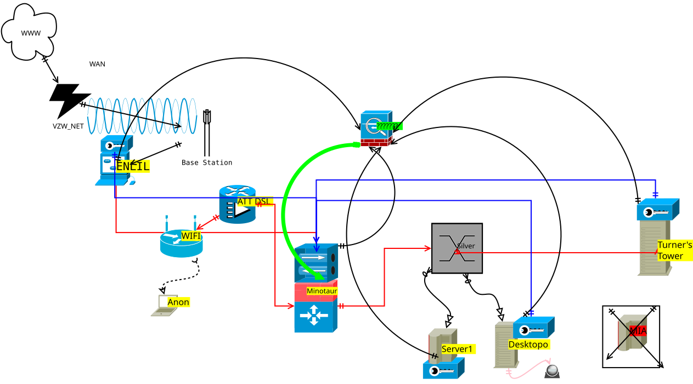

## Mermaid Diagram

Example Architecture of Home Lab in Mermaid

Currently, mermaid's architecture layout is still in _beta_ development, and therefore consequentially only offers a mere handful of icons for distinguishing features. There are currently:

* Disk
* Database
* apache
* Cloud
* Internet
Adding a custom icon pack to this lineup is an available option, but the investment to achieve uniform operational consistency across the several platforms used during the creation of this documentation far exceeds it's utility.

```mermaid
architecture-beta
    group homelab(home)[Home Lab]
    
    group pundit(database)[Pundit] in homelab
	    service pgsql(database)[Postgres] in pundit
    
    group titan(server)[Titan] in homelab
	    service apache(server)[Apache] in titan
	
	group orion(server)[Orion] in homelab
	    service nginx(server)[Nginx] in orion
	
	service router(internet)[Router] in homelab
	
	apache{group}:B --> T:router 
	nginx{group}:B --> T:router
	
	pgsql{group}:B -- T:apache{group}
	pgsql{group}:B -- T:nginx{group}

```

---

### Previous Network Diagram

Creating network diagrams using the _Dia_ diagram editor is a far easier approach.

